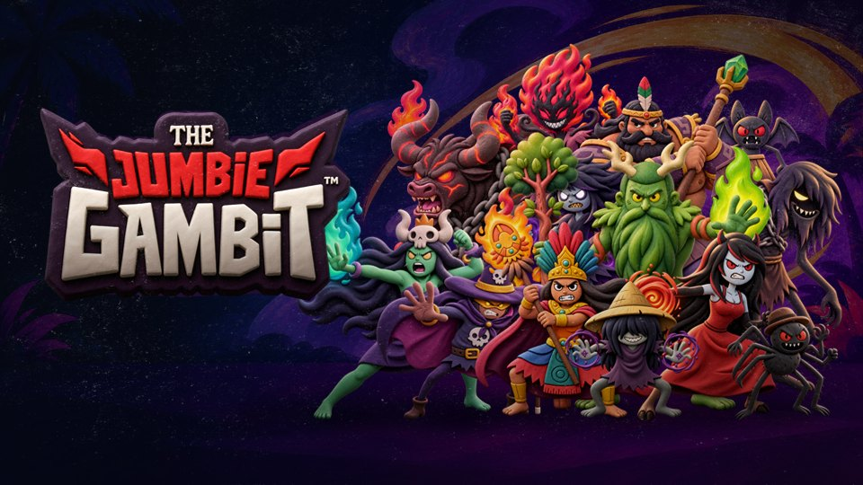

# The Jumbie Gambit: Spirits of Lore, Mystery & Bacchanal

A two-player card duel of tricks, magic and bluffing, featuring Caribbean monsters. Command the Sacred suit, sacrifice cards for powerful effects, and outwit your rival to bring their life to zero.

## Download the free demo

**Working Build 6.2** · released 18 Nov 2026 · expires 1 Jan 2027

| Platform | Download | Size |
|---|---|---|
| Windows 10 or later | [TheJumbieGambit-wb6.2-Windows.zip](https://github.com/nickseegobin/jumbie-gambit/releases/download/wb6.2/TheJumbieGambit-wb6.2-Windows.zip) | 104 MB |
| macOS | [TheJumbieGambit-wb6.2-Mac.zip](https://github.com/nickseegobin/jumbie-gambit/releases/download/wb6.2/TheJumbieGambit-wb6.2-Mac.zip) | 112 MB |

Download page with install help: **https://nickseegobin.github.io/jumbie-gambit/**

Feedback, bug reports and finding a duel partner: **[Discord](https://discord.gg/95H6acF4yM)**

Official site: https://efoundry.co/games/jumbie-gambit/

---

This repository hosts the public download page (GitHub Pages) and the build files (GitHub Releases). The game's source code is not in this repository.
